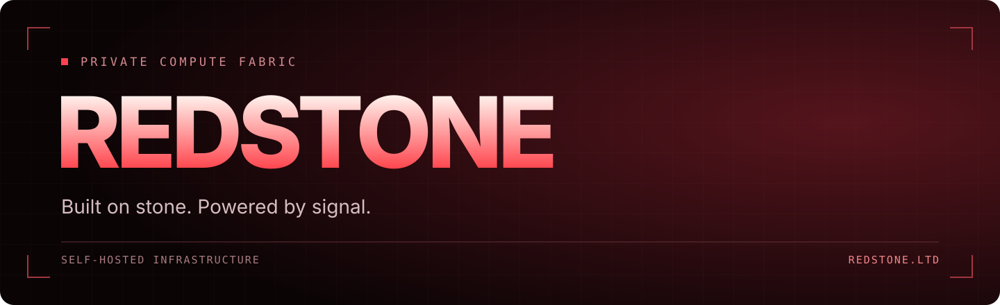

  

<h3 align="center">Infrastructure under our control.</h3>

A private compute fabric. 
Self-hosted systems, direct ownership, and a focus on the foundations.

  <a href="https://redstone.ltd"><strong>Explore REDSTONE ↗</strong></a>

---

<table>
<tr>
<td width="33%" valign="top">
<h3>01 · Signal</h3>
Clear logic. Deliberate systems. 
Every circuit is a decision.
</td>
<td width="33%" valign="top">
<h3>02 · Ownership</h3>
Self-hosted infrastructure. 
Control over the stack and the data.
</td>
<td width="33%" valign="top">
<h3>03 · Foundations</h3>
Compute, network, and software. 
Built to work together.
</td>
</tr>
</table>

REDSTONE · LTD &nbsp; / &nbsp; BUILT WITH SIGNAL · NOT NOISE

